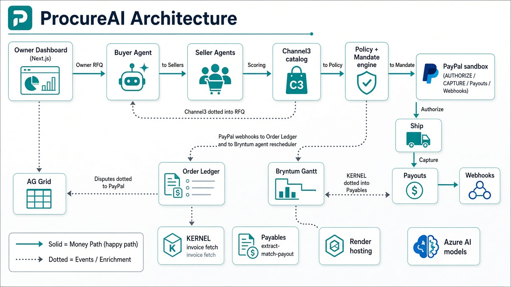
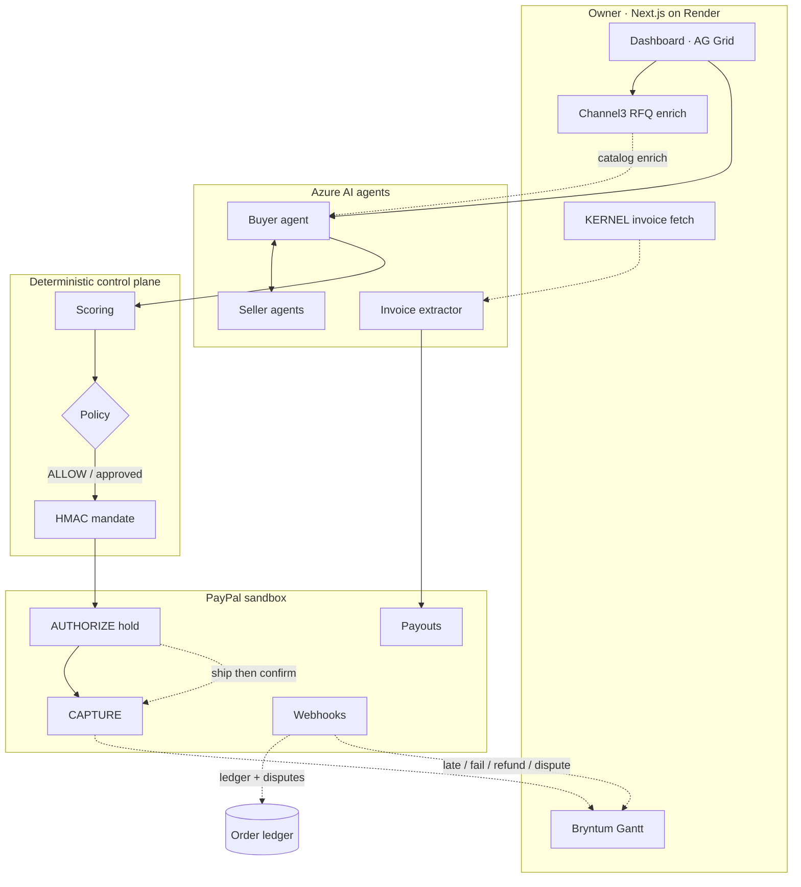

# Agentic Procurement

**ProcureAI** — AI agents that negotiate, buy and pay on PayPal: agentic procurement and payables for small businesses.

**Hosted demo:** https://agentic-procurement-web.onrender.com · **Devpost pack:** [`docs/DEVPOST_SUBMISSION.md`](docs/DEVPOST_SUBMISSION.md)

**Two tracks in one product:** (1) **Agent-to-agent marketplace** — buyer AI negotiates with seller AIs, scores offers, then PayPal authorize→capture. (2) **AI procurement & payables** — extract supplier invoices, three-way match, payouts, client invoicing, disputes.

> **Status:** PayPal AI Hackathon 2026 (sandbox only). Hosted on Render. Order totals above the policy approval threshold require human approval.


---

## What it does

1. **RFQ:** the owner asks for items, a quantity, a max unit price and a delivery deadline.
2. **Negotiate:** the buyer agent collects offers from seller agents and counters for up to 3 rounds, using its best alternative (BATNA) as leverage.
3. **Score:** offers are ranked with deterministic, intent-weighted scoring (price vs speed), learned from the owner's preferences.
4. **Govern:** a policy engine returns ALLOW, REQUIRE_APPROVAL or DENY. Approvals are recorded with an audit trail.
5. **Mandate:** an allowed or approved deal gets a short-lived, signed, single-use payment mandate.
6. **Pay safely:** PayPal authorize-then-capture. Funds are held on agreement and captured only after delivery is confirmed, voided on expiry, and refundable after capture.
7. **Track:** PayPal webhooks are verified and projected into a replay-safe order ledger, including disputes.

---

## Design & Engineering

I designed this so that **agents can negotiate, but money only moves through code paths that a human-set policy controls**. The LLM never decides whether to pay.

**Design goals**

- Let agents do the tedious part (asking, comparing, countering) in natural language.
- Keep every money decision deterministic, auditable and reversible until delivery.
- Treat all supplier and owner free text as data, never as instructions (prompt-injection safe by design).

**Architecture**





Legend: **solid** = primary money / negotiation path · **dotted** = enrichment & payment-driven reschedule.

**Key design decisions and trade-offs**

| Decision | Why | Trade-off |
|---|---|---|
| LLM writes the messages, code does the maths | Scoring, budget and deadline checks are deterministic and testable | Less "creative" deal-making |
| Policy engine with hard denies (blocked supplier, currency, budget, deadline, order cap, per-supplier cap) and an approval threshold | The owner sets the rules once; agents can't talk their way past them | Policy has to be configured per business |
| Signed payment mandates (HMAC-SHA256, 15-minute expiry, single use, must match the approved RFQ, supplier and total) | The payment tool refuses to move money without proof of a matching approval | A secret to manage (`MANDATE_SECRET`, 32+ chars) |
| Authorize-then-capture instead of paying upfront | Funds are held but not taken until delivery is confirmed | Authorizations expire, so an expiry sweep voids or reauthorizes them |
| Order state machine with guarded transitions and history | No impossible jumps (e.g. refund before capture); every change is audited | More states to model |
| Idempotent PayPal calls (`PayPal-Request-Id`) and replay-safe webhook processing | Retries and duplicate webhooks never double-charge or double-count | Event ids have to be tracked |

**Engineering details**

- **Stack:** TypeScript, Node.js, pnpm workspace, `tsx`, `zod`, Express with `helmet` and `express-rate-limit`.
- **Packages:**
  - `packages/agents`: `negotiation/` (buyer and seller agents, protocol, scoring, intent, preferences), `governance/` (policy, policy engine, approvals, mandates), `payments/` (payment tool, fulfillment, expiry), `orders/` (order state machine, ledger).
  - `packages/paypal`: OAuth token + REST client, plus `pnpm --filter paypal mcp` for the official PayPal Agent Toolkit MCP server (sandbox).
  - `packages/ai`: chat client with tool-calling (`chatWithTools`) against Azure AI; buyer/judge strong, seller/extractor fast.
  - `apps/api`: Express API with PayPal webhooks, Agent Toolkit–backed assistant/disputes/invoices, authorize→capture checkout.
- **PayPal Agent Toolkit:** `@paypal/agent-toolkit` (OpenAI adapter in the buying assistant; MCP stdio server for Cursor/Claude). Disputes list/get + owner-gated `accept_dispute_claim`; invoice create/send; order get; shipment/transactions tools.
- **Demos + eval:** runnable scripts in `packages/agents/src/demos/`; headless eval via `pnpm --filter agents eval` writes `docs/EVAL_REPORT.md` (savings + judge scores + mermaid charts).

**Ops notes**

- Postgres migrations live in `packages/db/migrations/` (including `0000_rollback.sql` for disposable DBs only — never run against Render prod). Run `0003_ap_toolkit.sql` for dispute drafts / AP tables.
- CI: `.github/workflows/ci.yml` (typecheck/lint/build + secret scan).
- API refuses to start unless `PAYPAL_ENV=sandbox` and `MANDATE_SECRET` is set.
- Dashboard: negotiation SSE feed, AG Grid `applyTransaction`, Payables panel (extract/match/payout/client invoice), Automation (FX/replenish/Slack/forecast) + partner panels.
- E2E checklist: `docs/TEST_PLAN.md`.
- Hackathon / sponsor tools used:
  - **PayPal** sandbox REST + Checkout AUTHORIZE, webhooks, Agent Toolkit/MCP
  - **AG Grid** Community (live grids)
  - **Render** web + API + Workflows package
  - **Channel3** catalog enrich (`CHANNEL3_API_KEY`, env-gated)
  - **Bryntum Gantt Enterprise** — agent reschedules milestones on PayPal capture/refund/dispute (`NEXT_PUBLIC_BRYNTUM_LICENSE_KEY` / `VITE_BRYNTUM_LICENSE_KEY` on web)
  - **KERNEL** invoice page fetch bridge (`KERNEL_API_KEY`, env-gated)
  - Slack approvals stretch (`SLACK_WEBHOOK_URL`)

**Judge path:** Overview → track cards → Seed negotiation **or** Open Payables.

---

## Quick start

Requires a recent Node.js LTS and pnpm, a PayPal developer **sandbox** app, and an Azure AI endpoint.

```bash
pnpm install
cp .env.example .env
# Fill in PAYPAL_CLIENT_ID, PAYPAL_CLIENT_SECRET, PAYPAL_WEBHOOK_ID, MANDATE_SECRET (32+ chars),
# and the AI settings read by packages/ai/src/config.ts:
#   AZURE_AI_ENDPOINT, AZURE_AI_API_KEY, AZURE_AI_DEPLOYMENT_STRONG, AZURE_AI_DEPLOYMENT_FAST

pnpm spike:paypal                               # check PayPal sandbox auth
pnpm --filter ai smoke                          # check the model endpoint
pnpm --filter agents negotiate-demo             # negotiation only
pnpm --filter agents policy-demo                # policy engine + approvals
pnpm --filter agents checkout-demo              # mandate + PayPal authorize/capture
pnpm --filter agents order-demo                 # order state machine
pnpm --filter agents expiry-demo                # authorization expiry sweep
pnpm --filter agents ledger-demo                # webhook -> ledger projection
pnpm --filter agents eval                       # 50-scenario report + judge scores
pnpm --filter paypal mcp                        # PayPal Agent Toolkit MCP (stdio, sandbox)
pnpm --filter api dev                           # API on :4000 (/health, webhooks, toolkit)
```

Policy knobs in `.env`: `POLICY_APPROVAL_THRESHOLD`, `POLICY_MAX_ORDER_TOTAL`.

## Repo layout

```
apps/api/                 Express API + PayPal webhooks (verify, store)
packages/agents/          negotiation, governance, payments, orders, demos
packages/paypal/          PayPal REST client
packages/ai/              model client and per-role routing
```

---

Built by [Suhail Ahmed](https://savvysuhail.com/): I design and build AI agents, LLM routers and RAG on cloud and data.
