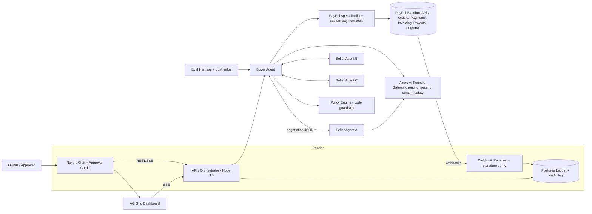
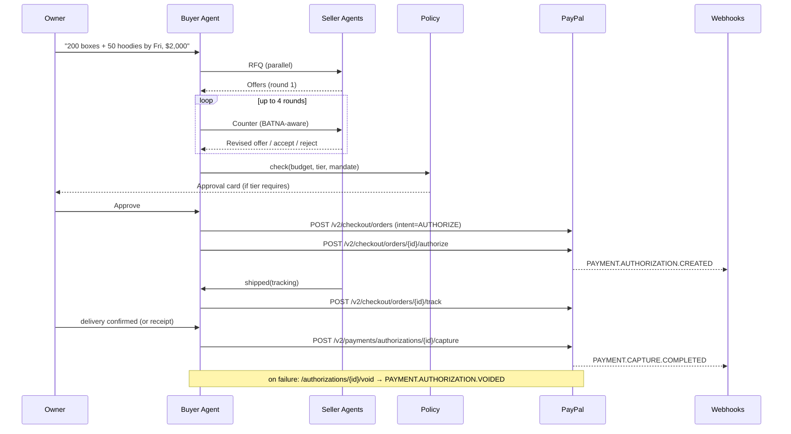
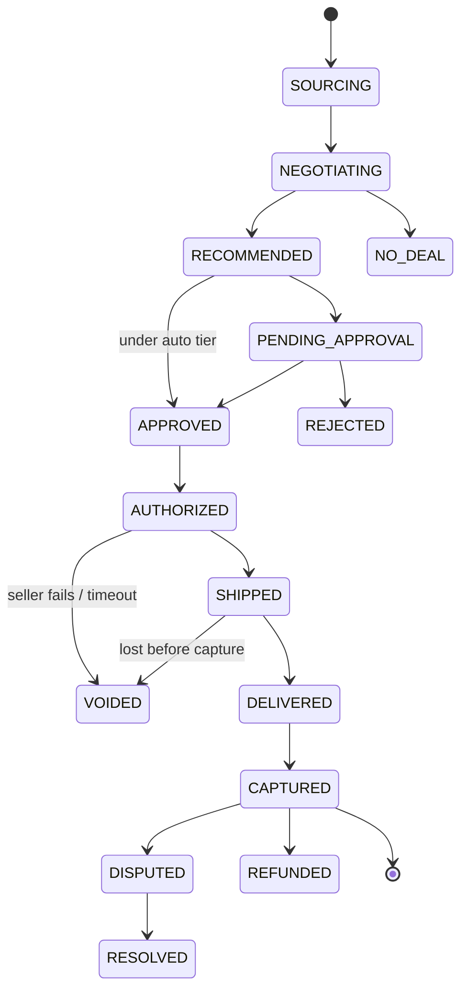

# 0. Fact check (verified 31 Oct 2026) vs. assumptions

| Item | Verified fact | Source |
|---|---|---|
| Orders v2 | `POST /v2/checkout/orders` (intent `AUTHORIZE`), `POST /v2/checkout/orders/{id}/authorize`, `/capture`, `/track` (add shipment tracking) | https://developer.paypal.com/docs/api/orders/v2/ |
| Capture/void an authorization | Done on **Payments v2**, not Orders: `POST /v2/payments/authorizations/{id}/capture`, `/void`, `/reauthorize`; refunds `POST /v2/payments/captures/{id}/refund` | https://developer.paypal.com/docs/api/payments/v2/ |
| Auth window | Authorization honor period 3 days, valid up to 29 days (reauthorize after honor period) — **assumption from PayPal docs memory; re-verify on Payments v2 page** | https://developer.paypal.com/docs/checkout/standard/customize/authorization/ |
| Agent Toolkit | `npm i @paypal/agent-toolkit`; works with OpenAI Agents SDK, LangChain, Vercel AI SDK, MCP. Tools include invoices (`create_invoice`, `send_invoice`, `list_invoices`…), orders (`create_order`, `get_order`, `pay_order`), disputes (`list_disputes`, `get_dispute`, `accept_dispute_claim`) | https://github.com/paypal/agent-toolkit |
| **Differs:** Toolkit has no authorize / void tool | We wrap Orders authorize + Payments capture/void as **our own typed tools** next to the toolkit tools | same |
| AI-Toolkit repo | It's a **coding-assistant plugin** (Claude Code / Codex / Cursor) + sandbox MCP server, not a runtime SDK. Use it to *build faster*; use `@paypal/agent-toolkit` at runtime | https://github.com/paypal/AI-Toolkit |
| Sandbox tokens | OAuth `POST https://api-m.sandbox.paypal.com/v1/oauth2/token` (client_credentials); tokens expire up to ~8h → refresh in code | AI-Toolkit README |
| docs.paypal.ai quickstart URLs | `.../mcp-quickstart` and `.../agent-toolkit-quickstart` returned **404** on 31 Oct; use GitHub READMEs | — |
| **Differs:** "open a dispute automatically" | Disputes are raised by the **payer** in PayPal's Resolution Center; the Disputes API lets the *merchant* list/respond/accept. No public API to *file* a dispute. Design: pre-capture problems → **void**; post-capture → **refund request / sandbox buyer-filed dispute** shown via `CUSTOMER.DISPUTE.CREATED` webhook; agent drafts the dispute evidence/message. | https://developer.paypal.com/docs/api/customer-disputes/v1/ |
| AG Grid | Community = MIT, free in prod: sorting, filtering, pagination, custom cell renderers, themes. **Enterprise** (watermark without key; 30-day trial key available): row grouping, aggregation/pivot, master/detail, integrated charts, Excel export, side bar/tool panels, server-side row model | https://www.ag-grid.com/react-data-grid/community-vs-enterprise/ |
| Payouts | `POST /v1/payments/payouts`; sandbox app must have Payouts enabled (assumption: enable in app settings) | https://developer.paypal.com/docs/api/payments.payouts-batch/v1/ |
| Invoicing | `POST /v2/invoicing/invoices`, `/{id}/send` | https://developer.paypal.com/docs/api/invoicing/v2/ |
| Webhooks | Verify with `POST /v1/notifications/verify-webhook-signature` | https://developer.paypal.com/docs/api/webhooks/v1/ |

**Role clarification (important for PayPal correctness):** the small business (our user) is the **payer** (sandbox *personal/business buyer* account). Each seller agent represents a **sandbox merchant** account (payee). Orders are created with the platform app and `purchase_units[].payee` = seller's merchant email/ID (assumption: single REST app acting for sellers via `payee`; simpler than multiparty onboarding).

# 1. Elevator pitch & target user

**Agentic Procurement** is an AI buyer for small businesses. The owner types *"We need 200 shipping boxes and 50 hoodies by Friday, budget $2,000"*; a buyer agent fans out to competing seller agents, negotiates over several rounds against a hard budget, recommends the best offer with a reason, asks for approval when policy requires, then **holds funds with a PayPal authorization** and **captures only when delivery is confirmed** — voiding or escalating automatically if anything goes wrong. The same agent runs everyday payables: it reads supplier invoices, three-way-matches them against POs and receipts, pays via PayPal Payouts, and bills clients with PayPal Invoicing. **Target user:** 5–50-person businesses (e-commerce shops, agencies, cafés) whose owner or office manager does purchasing by hand.

# 2. Goals, non-goals, metrics

**Goals:** end-to-end negotiate → approve → authorize → ship → capture in the PayPal sandbox; code-enforced spend policy; live dashboard; measurable savings via an eval harness; hosted demo on Render.
**Non-goals:** real money/production; real supplier integrations; Pay Later; multiparty partner onboarding; mobile app.
**Success metrics:** (a) core flow passes 10/10 scripted runs; (b) eval harness shows avg ≥10% savings vs list price with 0 policy violations across ≥50 simulated scenarios; (c) p95 negotiation < 45 s; (d) ≥8 distinct PayPal endpoints used; (e) video < 2:55.

# 3. Enhancements considered & prioritized feature set

Scores: T=Tech implementation, D=Design, I=Impact, N=Innovation, P=Presentation. Prizes: GP, AC (Agentic Commerce), PA (PayPal+AI), AG (AG Grid).

| # | Enhancement | Criteria lifted | Prize | Cost | Decision |
|---|---|---|---|---|---|
| 1 | Multi-round negotiation with BATNA (buyer knows best alternative, walks away) | N, T, P | AC, GP | M | **Must** |
| 2 | Simulated seller agents with distinct strategies (anchoring, bundler, slow-shipper-cheap, premium-fast) | N, P | AC | S | **Must** |
| 3 | Code-enforced budget/policy guardrails + approval tiers (auto < $500, owner < $2k, 2-person > $2k) | T, I | PA, GP | S | **Must** |
| 4 | Authorize-then-capture "escrow" + void on failure | T | GP, AC | M | **Must** |
| 5 | Immutable audit trail (hash-chained `audit_log`) | T, D | PA | S | **Must** |
| 6 | Webhook-driven ledger | T | GP | M | **Must** |
| 7 | AG Grid live dashboard | D, P | AG | M | **Must** |
| 8 | LLM-as-judge eval harness: savings vs list, policy violations, rationale quality | T, N | GP, PA | M | **Must** (cheap, huge credibility) |
| 9 | Agent identity / mandate tokens (signed JWT: who may spend how much on what, expiry) checked by seller + payment tool | N, T | AC | S–M | **Should** |
| 10 | Persistent supplier reputation (on-time, disputes, price honesty) feeds scoring | I, N | AC | S | **Should** |
| 11 | Invoice ingestion (PDF) + three-way match (PO ↔ receipt ↔ invoice) | I, T | GP | M | **Should** |
| 12 | Payouts to suppliers for matched invoices | T | PA | S | **Should** |
| 13 | Client invoicing via Agent Toolkit `create_invoice`/`send_invoice` | T | PA | S | **Should** |
| 14 | Dispute handling: webhook → agent drafts evidence, accepts/responds via Disputes API | T, I | GP | M | **Should** (auto *filing* not possible via API — see §0) |
| 15 | Shipment tracking pushed to PayPal (`/orders/{id}/track`) | T | GP | S | **Should** |
| 16 | Recurring replenishment ("reorder boxes when stock < 50") | I | GP | S | **Could** |
| 17 | Multi-currency / FX (USD/SGD/INR quotes, normalised) | I | GP | S | **Could** |
| 18 | Spend forecasting (Databricks/Snowflake) | I | — | L | **Could** (only if ahead; otherwise a simple SQL trend chart) |
| 19 | Slack/WhatsApp interface for approvals | D, I | — | M | **Could** (Slack approval button is the cheapest) |
| 20 | Agent-to-agent protocol over MCP/A2A-style JSON schema exposed publicly | N | AC | M | **Could** |

**Final:** **Must** = 1–8. **Should** = 9–15. **Could** = 16–20.

# 4. Architecture





**Order state machine**



**Data model (Postgres)**

| Table | Key columns |
|---|---|
| sellers | id, name, strategy, price_floor_pct, stock_json, lead_days, paypal_payee_email, reputation_score |
| requests | id, owner_id, text, items_json, budget, currency, deadline |
| negotiations | id, request_id, seller_id, round, status, batna_price |
| quotes | id, negotiation_id, round, sender(buyer/seller), unit_prices_json, total, delivery_date, terms, rationale |
| purchase_orders | id, request_id, seller_id, total, state, approval_tier, mandate_jti |
| approvals | id, po_id, approver, decision, ts |
| payments | id, po_id, paypal_order_id, authorization_id, capture_id, status, amount, expires_at |
| invoices | id, direction(in/out), po_id, paypal_invoice_id, vendor, amount, due, match_status, pdf_url |
| payouts | id, invoice_id, payout_batch_id, status |
| disputes | id, paypal_dispute_id, payment_id, reason, status, agent_draft |
| webhook_events | id(paypal event id, unique), type, payload, processed_at |
| audit_log | id, ts, actor, action, payload_json, prev_hash, hash |

# 5. Agent design

**Buyer agent tools:** `request_quotes(items, deadline)`, `counter_offer(seller, offer)`, `accept_offer`, `score_offers` (deterministic: price 50 / delivery 25 / reputation 25), `check_policy`, `request_approval`, `create_authorized_order`, `capture_payment`, `void_authorization`, `add_tracking`, toolkit `create_invoice`/`send_invoice`, `list_disputes`/`get_dispute`, `create_payout`, `extract_invoice(pdf)`.
**Seller agent tools:** `check_stock`, `price_floor` (hidden), `make_offer`, `mark_shipped`. Same template, config differs (strategy, floor, lead time, persona).

**Negotiation protocol** (JSON, validated with zod):
```json
{"type":"OFFER|COUNTER|ACCEPT|REJECT","negotiation_id":"n1","round":2,
 "lines":[{"sku":"BOX-M","qty":200,"unit_price":1.10}],
 "total":1890.00,"currency":"USD","delivery_date":"2026-11-06",
 "valid_until":"...","mandate":"<signed JWT>","rationale":"..."}
```
Rules: max 4 rounds; parallel across sellers; terminate on ACCEPT, all REJECT, or round cap; buyer never reveals budget; seller cannot go under its floor (enforced in code, not prompt); every message logged to `quotes` + `audit_log`.

**Guardrails (code, not prompt):** policy engine blocks any payment tool call where amount > mandate limit, > remaining budget, seller not allow-listed, or currency mismatch. Approval tiers: < $500 auto, $500–2,000 owner, > $2,000 two approvers (configurable). Payment tools take a server-issued `po_id`, never raw amounts from the LLM. Idempotency key = `po_id + action`. Azure AI Foundry gateway: model routing (small model for sellers, stronger for buyer/judge), prompt + response logging, content safety, token budgets per run.

**Human-in-the-loop:** approval card shows winner, runner-up, savings vs list, rationale, risk flags; Approve / Reject / Ask agent to renegotiate.

# 6. PayPal integration

| Step | Endpoint |
|---|---|
| Auth | `POST /v1/oauth2/token` (cache, refresh on 401) |
| Create | `POST /v2/checkout/orders` `intent: AUTHORIZE`, `payee` = seller |
| Payer approval | Sandbox buyer approves via PayPal button / approve link (demo: pre-logged sandbox buyer) |
| Authorize | `POST /v2/checkout/orders/{id}/authorize` |
| Tracking | `POST /v2/checkout/orders/{id}/track` |
| Capture | `POST /v2/payments/authorizations/{id}/capture` |
| Void | `POST /v2/payments/authorizations/{id}/void` |
| Refund | `POST /v2/payments/captures/{id}/refund` |
| Invoices | Toolkit `create_invoice`, `send_invoice` (`/v2/invoicing/invoices`) |
| Payouts | `POST /v1/payments/payouts` |
| Disputes | `GET /v1/customer/disputes`, accept/provide-evidence |
| Webhook verify | `POST /v1/notifications/verify-webhook-signature` |

**Sandbox accounts:** 1 buyer (business owner), 4 merchant accounts (sellers), 1 client personal account (invoice payer). **Webhooks:** `CHECKOUT.ORDER.APPROVED`, `PAYMENT.AUTHORIZATION.CREATED`, `PAYMENT.AUTHORIZATION.VOIDED`, `PAYMENT.CAPTURE.COMPLETED`, `PAYMENT.CAPTURE.REFUNDED`, `CUSTOMER.DISPUTE.CREATED/UPDATED/RESOLVED`, `INVOICING.INVOICE.PAID`, `PAYMENT.PAYOUTSBATCH.SUCCESS`. **Idempotency:** `PayPal-Request-Id` header on every POST; `webhook_events.id` unique. **Errors:** retry 5xx/429 with backoff; `UNPROCESSABLE_ENTITY` → surface to agent as structured error; authorization expiry job reauthorizes or voids.

Note: the order requires **payer approval** before authorize — the agent cannot silently spend. This is a feature for the trust story (owner's PayPal approval = final mandate). Demo uses the sandbox buyer login once.

# 7. Security & trust
Approval tiers + mandate JWT (scope, max amount, expiry, signed with server key); hash-chained audit log viewable in UI; secrets only in Render env vars / `.env` (gitignored), never in prompts; webhook signature verification; LLM output never directly maps to money fields; rate limits per run; sandbox-only flag enforced at startup.

# 8. UI/UX
Screens: **Chat** (request + streaming negotiation feed), **Approval card**, **Dashboard**, **Order detail** (timeline + audit), **AP inbox** (invoices + match status), **Evals** report.
AG Grid widgets (Community unless marked): Negotiation feed (live row updates via `applyTransaction`, custom cell renderer for price deltas); Pending approvals (action button renderer); Held funds (authorized amount, expiry countdown); Captured; Disputes; Supplier reputation. **Enterprise (trial key/watermark):** row grouping by seller, aggregation totals, master/detail (order → rounds), integrated charts (spend by seller), Excel export. Plan: build on Community, add Enterprise features behind a flag and request 30-day trial key for the AG Grid prize.

# 9. Repo, stack, env
```
agentic-procurement/
  apps/web        Next.js 15 (App Router), AG Grid, Tailwind
  apps/api        Node/TS (Hono or Fastify), agents, webhooks, SSE
  packages/agents buyer, seller, protocol (zod), policy
  packages/paypal client, toolkit wiring, custom tools
  packages/db     Drizzle + Postgres migrations
  evals/          scenarios, LLM judge, report
  docs/           ARCHITECTURE.md, SETUP.md
  render.yaml
```
Env: `PAYPAL_CLIENT_ID`, `PAYPAL_CLIENT_SECRET`, `PAYPAL_ENV=sandbox`, `PAYPAL_WEBHOOK_ID`, `AZURE_AI_ENDPOINT`, `AZURE_AI_KEY`, `MODEL_BUYER`, `MODEL_SELLER`, `MODEL_JUDGE`, `DATABASE_URL`, `MANDATE_SIGNING_KEY`, `AG_GRID_LICENSE_KEY` (optional), `APPROVAL_TIERS`.

# 10. Day-by-day plan (IST)
Owners: **S** = Suhail, **A** = assistant (code, docs, issues, scripts).

| Date | Work | Owner | Milestone |
|---|---|---|---|
| Sat 31 Oct | Docs, repo scaffold, issues; sandbox app + 6 accounts | A / S | |
| Sun 1 Nov | Monorepo, DB schema, PayPal client + OAuth, create/authorize/capture/void script | A+S | |
| Mon 2 Nov | Webhook receiver + verify, Azure gateway wiring | S | **M1** Foundations |
| Tue 3 Nov | Protocol + seller agent template, 4 strategies | A | |
| Wed 4 Nov | Buyer agent, BATNA, scoring, parallel rounds | S | |
| Thu 5 Nov | Chat UI streaming negotiation; eval harness v0 | A | **M2** Agents |
| Fri 6 Nov | Policy engine, tiers, approval cards, mandate JWT | S | |
| Sat 7 Nov | Full order flow + state machine + tracking; void path | S+A | |
| Sun 8 Nov | Dispute webhook + agent draft; audit log | A | **M3** Payments |
| Mon 9 Nov | AG Grid dashboard; reputation | A | |
| Tue 10 Nov | Invoice PDF extraction + 3-way match + payouts + client invoice (stretch) | S | **M4** |
| Wed 11 Nov | Render deploy, seed data, eval report, README; record video | S | |
| Thu 12 Nov | Buffer, final video edit, Devpost submit by 18:00 IST | S | **M5** |

**Cut list (in order):** forecasting → Slack → FX → replenishment → payouts → invoicing/3-way match → dispute drafting → mandate JWT. Never cut: negotiate, approval, authorize, capture, void, webhooks, dashboard, eval numbers.

# 11. Demo script (2:50)
0:00–0:15 hook: "SMB owners waste hours haggling and chasing payments. Watch an agent buy for you, safely."
0:15–0:50 type request; four seller agents stream offers; buyer counters using BATNA.
0:50–1:10 recommendation: "Seller B, $1,742, 13% under list, arrives Thu"; approval card (tier 2).
1:10–1:40 PayPal sandbox approve → authorization; dashboard "Held $1,742".
1:40–2:05 seller marks shipped (tracking to PayPal), owner confirms delivery → capture; webhook updates grid.
2:05–2:20 failure path: seller C misses date → auto void.
2:20–2:35 AP: drop supplier PDF → matched → payout.
2:35–2:50 eval chart: avg savings %, 0 policy violations over N runs; architecture slide; close.
Storyboard: screen capture 1080p, picture-in-picture face optional, captions, one architecture slide.

# 12. Devpost checklist & draft text
- [ ] Hosted URL (Render) · [ ] Public repo, MIT · [ ] YouTube public < 3 min · [ ] Description · [ ] Tools list: PayPal Orders/Payments/Invoicing/Payouts/Disputes/Webhooks, PayPal Agent Toolkit, Azure AI Foundry, Next.js, AG Grid, Render, Postgres · [ ] "Built after Oct 1" statement · [ ] Choose sponsor prize: AG Grid.

**Draft description:** *Agentic Procurement is an AI purchasing department for small businesses. Describe what you need and your budget; a buyer agent negotiates in parallel with competing seller agents, recommends the best deal, and pays through PayPal with authorize-then-capture so money moves only when goods arrive. Spend limits, approval tiers and signed mandates are enforced in code, every action lands in a tamper-evident audit log, and an eval harness proves the agent saves money without breaking policy. It also automates payables: invoice extraction, three-way matching, PayPal Payouts and client invoicing — all live on an AG Grid dashboard.*

# 13. Where to build & credits (short)
Render (free web service + Postgres; hackathon credits per Devpost sponsor page) https://render.com · PayPal sandbox https://developer.paypal.com/dashboard · AG Grid trial key https://www.ag-grid.com/license-pricing/ · Azure AI Foundry (Suhail's existing gateway). Detailed credit research handled by another worker.

# 14. Risks & mitigations
| Risk | Mitigation |
|---|---|
| Payer approval step breaks "autonomous" story | Frame as owner's final mandate; one-click sandbox approve |
| Authorization expiry | Expiry job, demo within honor period |
| LLM loops / cost | Round cap, token budget at gateway, cheaper seller model |
| Webhooks unreachable locally | Render deploy early (M1); simulator endpoint |
| AG Grid Enterprise watermark | Trial key or Community-only fallback |
| Dispute filing not possible via API | Demo buyer-filed sandbox dispute; agent responds |
| Scope creep | Cut list; Must set frozen by Nov 8 |
| Solo bandwidth | Assistant owns scaffolding, UI, docs, evals |
