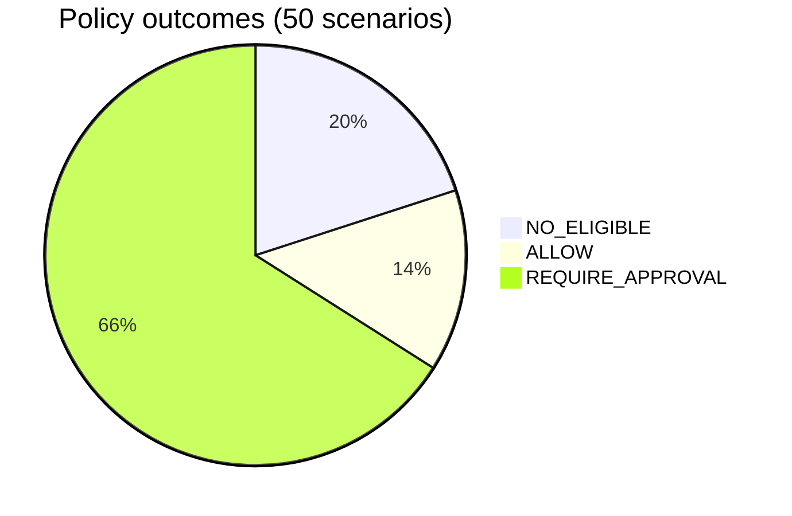
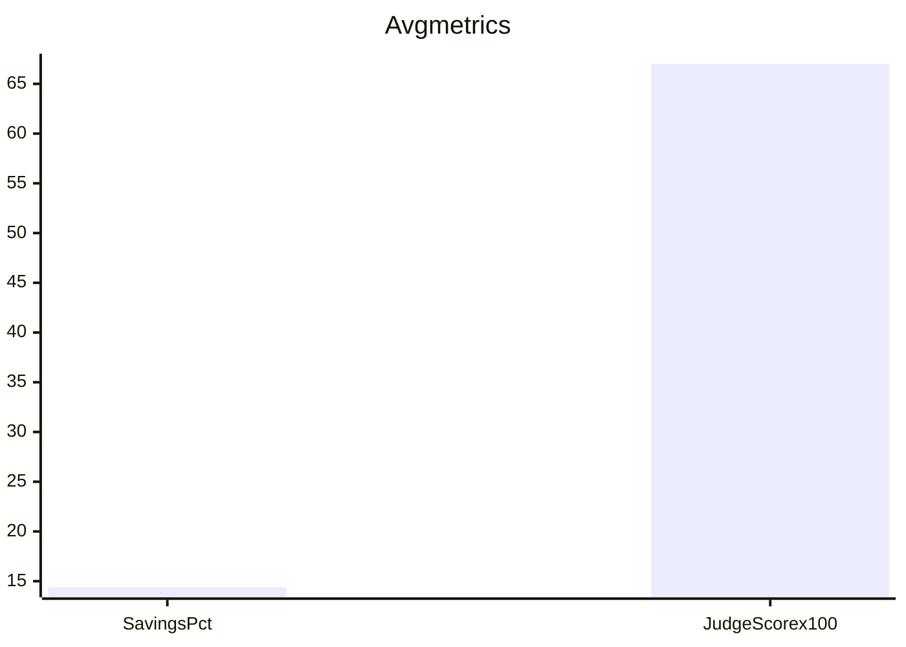

# Eval report v0

Generated: 2026-11-09T03:05:59.222Z

- Scenarios: **50** (headless, synthetic offers — no live LLM calls)
- Winners found: **40**
- Avg savings vs list: **$948.89** (14.4%)
- Avg judge score: **0.673** (`JUDGE_V0_heuristic`)
- Policy outcomes: NO_ELIGIBLE=10, ALLOW=7, REQUIRE_APPROVAL=33
- Policy / eligibility issues: **10**

## Chart (for video / Devpost)





Policy used for this run:

```json
{
  "maxOrderTotal": 50000,
  "approvalThreshold": 2500,
  "maxPerSupplierTotal": {},
  "blockedSuppliers": []
}
```

Full machine-readable results: `docs/EVAL_REPORT.json`.
